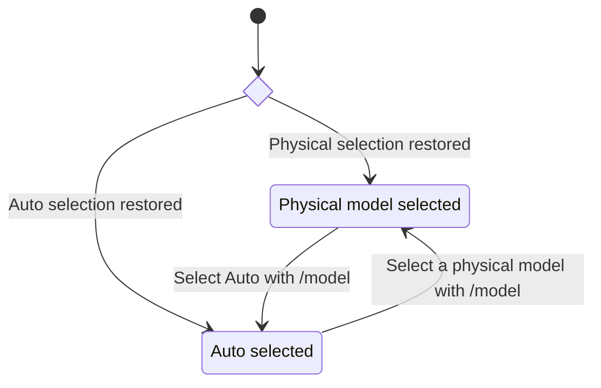
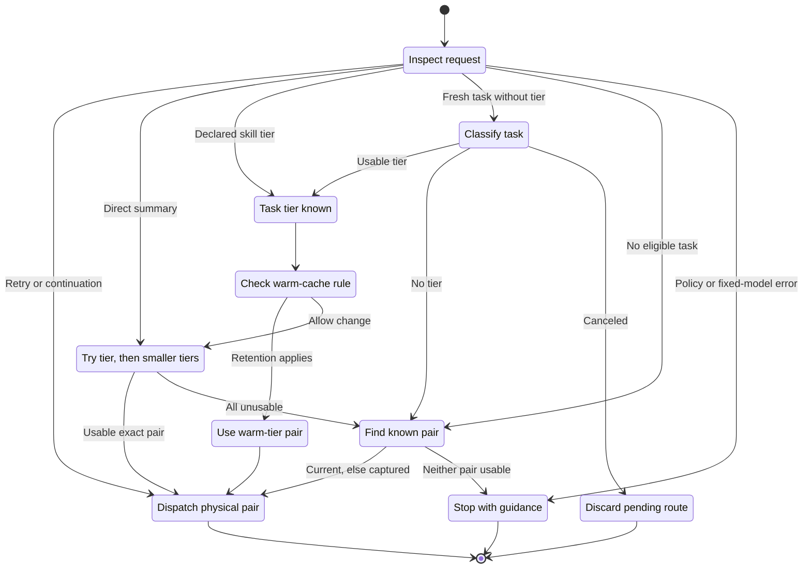

# Model state transitions

Auto has two separate kinds of state: the model selected in Pi's picker, and
the physical model and effort used for a request. Routing changes the second
without replacing the `pi-auto-model/auto` selection.

A **pair** means a physical model plus its effort. The **current pair** comes
from the active branch's latest usable physical evidence. The **captured
pair** is the known physical selection retained for fallback and effort-only
routing.

## Entering and leaving Auto

Pi owns startup and resumed selection. Installing the extension or saving an
Auto preference does not select Auto. There is no `/automodel on` or `off`.

| Setting                                     | Effect while Auto is selected                                                                     |
| ------------------------------------------- | ------------------------------------------------------------------------------------------------- |
| `model-and-effort`                          | A tier supplies both the physical model and effort.                                               |
| `effort-only`                               | Keep the captured physical model, and choose a tier's effort. A known physical model is required. |
| `configure`                                 | Save global mappings without changing selection or mode.                                          |
| `temp bedrock`, `temp gemini`, `temp clear` | Replace or restore the session's effective mappings without changing selection or mode.           |

Control changes wait for a safe idle point when the session is busy. Temporary
presets follow the active branch and survive reload or resume of that session,
but do not become global defaults. Saving global mappings leaves an active
preset in place.

## Routing one request

This diagram applies only while Auto is selected. Each terminal state ends
this routing decision, not the Auto session.

### Which inputs can choose a new tier?

| Input or request                                                                             | Routing rule                                                                                                                                                         |
| -------------------------------------------------------------------------------------------- | -------------------------------------------------------------------------------------------------------------------------------------------------------------------- |
| Fresh typed task                                                                             | Classify its text only when Auto is idle and has no pending messages.                                                                                                |
| Explicit, loaded `/skill:name`                                                               | Use valid `metadata.model-tier`, otherwise classify its name and description. Slash arguments do not affect the tier.                                                |
| Confirmation, number-only reply, or empty text                                               | Do not classify. Retain known physical evidence. There is no general fewer-than-four-words exemption.                                                                |
| Other slash command, extension input, steering, queued input, or unverified/transformed task | Do not treat it as a new tier-selection task.                                                                                                                        |
| Tool continuation                                                                            | Reuse the known current pair without classification.                                                                                                                 |
| Retry with a known failed pair                                                               | Retry that same pair. A live provider failure does not trigger tier escalation.                                                                                      |
| Direct request, such as a summary                                                            | Use the mapped `summaryTier` pair, even in effort-only mode, without classification or the warm-cache rule. This does not replace the saved main-conversation route. |

Skill metadata is trusted only for the loaded resource behind the explicit
slash command. Pasted skill blocks do not count. The accepted task must still
match the finalized user message, session, and branch before it can route.

### Tier and cache rules

Tier order is `trivial < moderate < complex < frontier`. A tier increase need
not change models: mappings may reuse a model with different efforts. The
classifier judges the immediate action, not the broader project mentioned as
background:

| Tier       | Typical task                                                                              |
| ---------- | ----------------------------------------------------------------------------------------- |
| `trivial`  | Mechanical work, short writing, factual answers, direct lookups.                          |
| `moderate` | Hands-on code changes, debugging, tests, multi-file work, code explanation or comparison. |
| `complex`  | Specs, plans, research, architecture, code or security review.                            |
| `frontier` | Whole-system redesign or planning a very large migration.                                 |

The cache is treated as **warm for less than one hour after the active
branch's last successful assistant message**, provided a saved tier exists.
An equal or smaller task tier keeps the warm tier when its effective model
still matches the current model and its configured effort is supported. The
warm tier's configured effort is applied, so effort can change without a model
switch. A larger tier proceeds to candidate selection.

A changed model mapping for the warm tier bypasses that retention check. The
new task then routes normally, even while warm. In effort-only mode, the model
comparison uses the fixed model, not the tier's mapped model. At one hour or
later, the task may move either up or down.

### Candidate selection and failure

1. Try the selected tier, then each smaller tier. Never search larger tiers
   to compensate for an unavailable target.
2. In model-and-effort mode, use the candidate's exact pair. In effort-only
   mode, test the candidate's effort against the captured fixed model.
3. A candidate needs a physical catalog entry, configured authentication,
   inclusion in the available catalog, and support for the exact effort.
   Unsupported effort is not silently clamped.
4. If classification yields no tier, or every candidate fails, retain a usable
   current pair, then a usable captured pair. In effort-only mode, retained
   evidence must match the fixed model. This retention validates identity and
   effort, not fresh authentication or live entitlement.
5. If no pair is usable, stop with physical-selection guidance. Routes that
   evaluate policy also stop on invalid configuration rather than inventing
   a pair. Sticky retries and continuations bypass policy evaluation.

Classifier errors, timeout, unavailable access, or invalid output yield no
tier. There is **no keyword guess or default task tier**. The classifier's
configured bounds default to 12,000 input characters, 256 output tokens, and
6 seconds, with no tools or retries.

Cancellation, model selection, session replacement, or branch navigation
invalidates pending task intent. A late classifier result cannot dispatch into
another session or branch. Saved physical evidence is restored from the active
branch rather than borrowed from another branch.

## Sources and behavioral checks

- [Routing policy and classifier](../src/policy.ts).
- [Request ownership, retry, continuation, and cache timing](../extensions/auto-model.ts).
- [Mode, preset, and idle-boundary controls](../src/controls.ts).
- [Policy tests](../test/policy.test.ts), [routing tests](../test/tier-routing.test.ts),
  and [request-ownership tests](../test/request-ownership.test.ts).
